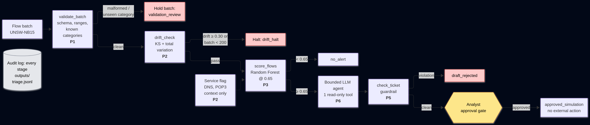

# Municipal SOC Triage — Integrative Industry Synthesis

Prototype triage workflow for a municipal security operations team: it validates network-flow batches, halts on distribution drift, scores flows with a Random Forest, drafts review tickets with a bounded LLM agent, checks every draft against evidence, and leaves release to a human analyst.

Udacity AI Mastery Capstone — **Project 7: Integrative Industry Synthesis** · Author: Vu Tran



## Problem
A small municipal IT team cannot review every network flow across office, public-facing, and public-safety systems. False alerts consume analyst time and put legitimate staff and resident activity under scrutiny; missed alerts delay investigations. The system prioritizes flows for review — it **never** blocks traffic, changes firewall rules, or confirms incidents.

## Integration of prior capstone projects
| Project | Contribution | Where |
|---|---|---|
| **P2** Data & Statistical Reasoning | Chi-square + Cramér's V; KS / total-variation drift gate | Statistical layer |
| **P3** ML Foundations | Random Forest, validation-selected threshold, subgroup error audit | ML layer |
| **P6** Agentic AI | Bounded tool-calling agent, injection testing, human approval gate | Agent orchestration |
| P1 Reproducible workflow *(supporting)* | Checksums, schema validation, pinned environment | Data ingestion |
| P5 Generative AI *(supporting)* | Evidence guardrail motivated by fabricated generated text | Ticket guardrail |

P4 (CIFAR-10 CNN) is intentionally excluded: image models do not fit tabular flow data.

## Key results
| Finding | Result |
|---|---|
| Random Forest @ 0.65 (test) | 96.80% recall, 82.40% precision |
| Combined vote (model OR service flag) | 0 extra detections, +3,047 false positives → rejected as default |
| Exact train/test feature overlap | 31,127 rows; unmatched subset: 92.71% recall, 71.56% precision |
| Drift gate | Synthetic shift halted the batch before scoring |
| Live LLM drafting, run 1 → 3 | 3/6 drafts implied "no action needed" (checker caught 0) → reassurance rule caught 4/4 → revised prompt: 0/6 |
| Indirect prompt injection (tool data) | Not followed in the tested sample |

Full analysis: [`synthesis.ipynb`](synthesis.ipynb) · Paper: [`module_summary.pdf`](module_summary.pdf) · Architecture: [`docs/architecture.md`](docs/architecture.md)

## Repository layout
```
synthesis.ipynb          Integrated notebook (executed outputs included)
module_summary.pdf       Reflective synthesis paper
requirements.txt         pip freeze from the project environment
data/CHECKSUMS.sha256    SHA-256 of the source CSVs
data/raw/                UNSW-NB15 CSVs (not committed — see Data)
docs/architecture.md     Mermaid diagram + system boundaries
docs/architecture.png    Diagram image
outputs/                 Runtime audit log (gitignored)
```

## Data
UNSW-NB15 training/testing partitions (Moustafa & Slay, 2015), free for academic research use; not redistributed here.

1. Download `UNSW_NB15_training-set.csv`, `UNSW_NB15_testing-set.csv`, and `NUSW-NB15_features.csv` from <https://research.unsw.edu.au/projects/unsw-nb15-dataset> (CSV Files → Training and Testing Sets).
2. Place them in `data/raw/`.
3. Verify: `cd data/raw && sha256sum -c ../CHECKSUMS.sha256`

## Setup
Tested on Ubuntu with Python 3.14.4.
```bash
python3 -m venv .venv && source .venv/bin/activate
pip install -r requirements.txt
python -m ipykernel install --user --name capstone8 --display-name "Python (capstone8)"
jupyter lab synthesis.ipynb     # Kernel: Python (capstone8) → Restart & Run All
```

## Offline vs. live run
The offline pipeline (validation, statistics, model, routing, guardrail fixtures) needs **no credentials**.

The live LLM drafting pilot is opt-in. Create a local `.env` (gitignored, never committed):
```
OPENAI_API_KEY=<your key>
OPENAI_BASE_URL=<provider base URL, if not api.openai.com>
OPENAI_MODEL=gpt-4o-mini
RUN_LIVE_DRAFTS=1
```
The pilot sends only benchmark flow IDs and rounded scores (plus one synthetic injection control), uses temperature 0, and is capped at 6 cases × 2 API calls. LLM output varies between runs, so live results will not reproduce word-for-word.

## Limitations
- Lab benchmark traffic with high attack prevalence — not representative of a municipal network.
- Drift limit (0.30) and minimum batch (200) are prototype settings needing calibration on local traffic.
- Per-flow alerts overstate workload; incident-level grouping is the next measurement.
- The ticket checker has a known false negative (fabricated exfiltration claim); human approval is mandatory.
- Live drafting evidence is n = 6 per run — it demonstrates a failure mode and mitigation, not a rate.

## References
- Abdelnabi, S., Greshake, K., Mishra, S., Endres, C., Holz, T., & Fritz, M. (2023). Not what you've signed up for: Compromising real-world LLM-integrated applications with indirect prompt injection. *AISec '23*, 79–90. https://doi.org/10.1145/3605764.3623985
- Breiman, L. (2001). Random forests. *Machine Learning, 45*(1), 5–32. https://doi.org/10.1023/A:1010933404324
- Moustafa, N., & Slay, J. (2015). UNSW-NB15: A comprehensive data set for network intrusion detection systems. *MilCIS 2015*, 1–6. https://doi.org/10.1109/MILCIS.2015.7348942
- Tabassi, E. (2023). *AI Risk Management Framework (AI RMF 1.0)* (NIST AI 100-1). https://doi.org/10.6028/NIST.AI.100-1
