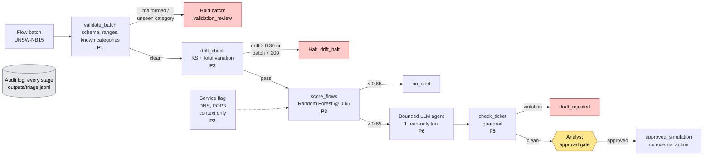
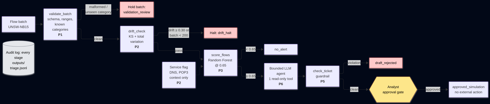

# Architecture: Municipal SOC Triage

## System boundaries
| The system does | The system does not |
|---|---|
| Validate, drift-check, score and rank flows | Block traffic, change firewall rules, or take personnel action |
| Draft a review ticket from flow ID and score only | Confirm incidents or name CVEs, hosts or users |
| Log every stage for reconstruction | Release anything without explicit analyst approval |

## Prior-project integration
- **P1:** validation gate and reproducibility (checksums, seed, pinned environment)
- **P2:** chi-square association test, service-rate flag, drift gate
- **P3:** Random Forest, validation-selected threshold, subgroup error audit
- **P5:** guardrail motivated by fabricated generative output
- **P6:** bounded tool-calling agent with a stage cap and human approval
